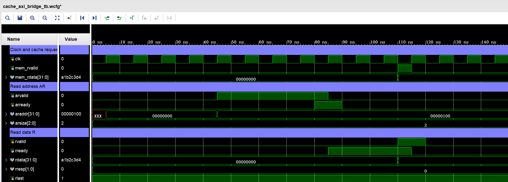
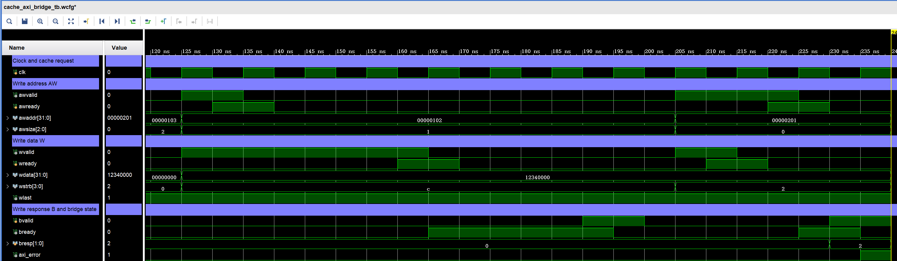

# AXI 仿真波形解读

判读规则：AXI 每个通道的 `VALID`、`READY` 在**同一个时钟上升沿**均为 1，才完成一次握手。高电平持续多周期并不等于传输了多次。`Value` 列显示的是 Vivado 光标所在时刻的值，不代表整段波形。

## Vivado 直接截图：读事务

测试台向桥接模块发出内部地址 `0x103` 的读请求。AXI 侧按 32 位字访问，故 `ARADDR=0x100`，`ARSIZE=2` 表示一拍 4 字节。`ARVALID` 拉高后，`ARREADY` 暂时为低；在等待期间，地址和传输属性保持稳定。85 ns 的时钟上升沿，AR 通道完成握手。

随后桥接模块拉高 `RREADY` 等待返回数据。测试台给出 `RVALID=1`、`RDATA=A1B2C3D4`、`RRESP=0`、`RLAST=1`；115 ns 上升沿 R 通道握手，读数据才被接收。`RRESP=0` 为正常响应，`RLAST=1` 表示该单拍读事务的最后一拍。测试台同时检查内部 `mem_rvalid` 不会在 AR 阶段提前出现。

## Vivado 直接截图：写事务

第一笔从地址 `0x102` 发起，`AWSIZE=1` 表示半字，`WDATA=12340000`、`WSTRB=C`（`1100`）表示仅高两个字节有效。虽然 AW 与 W 同时发起，但 AW 在 135 ns 先握手，W 保持有效至 165 ns 才握手；195 ns 收到 B 响应后，写事务完成。这验证了两个独立通道可在不同周期被接收。

第二笔是地址 `0x201` 的字节写，`AWSIZE=0`、`WSTRB=2`（`0010`）。W 在 215 ns 先握手，AW 在 225 ns 后握手，覆盖了反过来的顺序。测试台故意返回 `BRESP=2`（`SLVERR`）；235 ns B 握手后 `axi_error` 置位。截图右侧错误标志为 1 是该负向测试的预期结果。

## 五级 CPU 集成波形

CPU 的原始数据库在 `../Important/AXI_PASS/cpu/mycpu_top_axi_tb.wdb`。测试程序经 I/D Cache 和 AXI 取指与访存，执行缓存区 store/load、load-use 相关和 MMIO 写。约 1245 ns，AW/W 在地址 `BFAFF050`、数据 `0000012A`、`WSTRB=F` 的条件下握手；1295 ns B 响应握手。最终写回 `r29=0000012B`，MMIO 模型值为 `0000012A`，`axi_error=0`。完整计数和断言见 [PASS 汇总](../Important/Summary/关键PASS输出汇总.md)。

## 辅助放大图的来源

`../Supplementary/` 的三张 PNG 由同一套测试台在 Vivado 2018.3 XSim 中重新运行、导出 VCD 后绘制。它们是真实信号数据的局部展示，但**不是 Vivado 界面的截图**；报告若要求 Vivado 波形截图，应优先使用上面两张直接截图或打开 WDB 重新截取。
